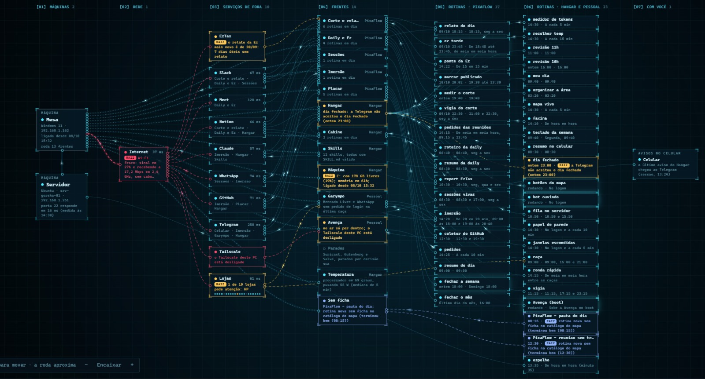

# Painel

Parte da [Documentação](README.md).

## Referência Visual

O painel de referência que serviu de ponto de partida:

## Características da Interface

- Fundo escuro com grade sutil e tipografia monoespaçada
- Cartões com cantos em colchete, indicador visual de status e texto explicativo sucinto
- Colunas estruturadas:
  - `[01] MÁQUINA`
  - `[02] SERVIÇOS`
  - `[03] FRENTES`
  - `[04] ROTINAS`
  - `[05] COM VOCÊ`
- Fios curvos tracejados e animados interligando as colunas, refletindo o fluxo e o estado dos componentes
- Etiqueta `RAIZ` no cartão onde um problema se inicia, acompanhado da causa
- Latência em milissegundos reportada junto a cada serviço
- Controles interativos na base: arrastar para mover o canvas, rolagem para zoom e botão **Encaixar**

## Recursos Interativos

- **Painel lateral ao clicar no cartão:** histórico de execuções, log de console detalhado, itens coletados e ação **Rodar agora**
- **Atualização em tempo real (SSE):** indicadores visuais de processamento enquanto a rotina executa e transição de cor automática ao finalizar, sem recarregamento de página

## Fluxo do Mapa

O fluxo visual propaga-se da esquerda para a direita. Um traço vermelho ou âmbar mapeia a propagação de falha: do serviço indisponível para a frente afetada e as rotinas suspensas. Cartões em tom cinza representam serviços ou rotinas aguardando configuração de credenciais.

## Personalização e celular

- **Faixa "Hoje"**, abaixo da barra de organização: contador de problemas (o mesmo do título da aba) e os últimos textos do briefing, do resumo de mensagens e do fechamento do dia. Clique num deles para ler inteiro. Os textos vêm de `/api/hoje`, lido na própria página (nunca do `estado.js`, que qualquer site poderia incluir).
- **Gráfico da máquina:** o cartão da máquina mostra CPU (azul) e memória (âmbar) das últimas 24 horas, e a gaveta da máquina mostra o gráfico maior. Os buracos (PC desligado) aparecem como buracos. Dados de `/api/maquina/historico?horas=24` (até 168).
- **Título e ícone da aba** mudam com o estado: "Automateum (3 problemas)", ícone na cor do pior estado, e "mapa parado" se o estado tem mais de 15 min.
- **Densidade e texto:** botões na base (ou teclas `D`, `[` e `]`): cartões compacto/normal/espaçado e texto de 90% a 130%. Ficam guardados no navegador.
- **Modo painel (tecla `P`, botão Painel ou `/?parede=1`):** tela cheia sem controles, só a faixa Hoje com relógio e o mapa, que continua se atualizando. `Esc` sai. A tela do aparelho não apaga enquanto ele está ativo, quando o navegador permite.
- **Celular:** em telas estreitas (até 760 px) o mapa vira uma lista: o que precisa de você, a máquina, as frentes com suas rotinas e os serviços de fora. Tocar num item abre a gaveta. É só leitura.

